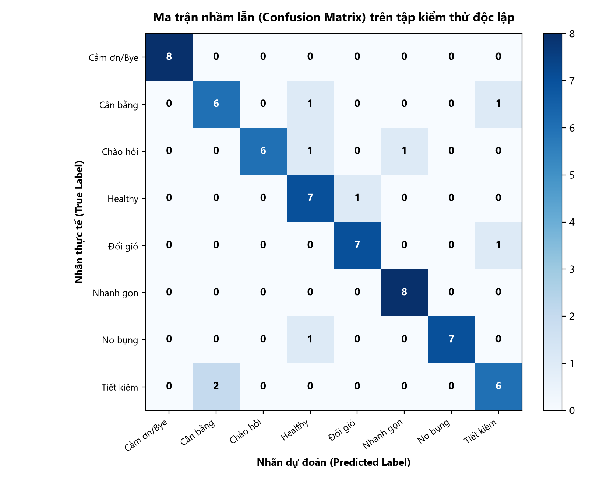

# 🍜 NEU Lunch Chatbot - Trưa Nay Ăn Gì?

> **Hệ thống Chatbot tiếng Việt tư vấn bữa trưa thông minh dành riêng cho sinh viên Trường Đại học Kinh tế Quốc dân (NEU - Hà Nội).**  
> Dự án ứng dụng kỹ thuật Xử lý ngôn ngữ tự nhiên (NLP) với TF-IDF kết hợp mô hình học máy Multinomial Naive Bayes (scikit-learn) để phân loại nhu cầu người dùng, tích hợp thuật toán chấm điểm đa tiêu chí (MCDM) và giao diện trực quan PyQt6.  
> Đây là sản phẩm phục vụ bài tập lớn môn **Trí tuệ nhân tạo (Artificial Intelligence)**.

> 💡 **Bạn không rành về kỹ thuật/lập trình?** Xem ngay [📘 Hướng dẫn chi tiết cho người Non-Tech tại đây](HUONG_DAN_SU_DUNG.md) để bắt đầu sử dụng và huấn luyện mô hình bằng giao diện đồ họa một cách dễ dàng nhất!

---

## 🌟 Tính năng chính

1. **Nhận biết nhu cầu ăn uống (Intent Classification)**:
   - Tự động phân loại câu hỏi tiếng Việt vào 8 nhóm ý định: `tiet_kiem` (Tiết kiệm), `healthy` (Ăn lành mạnh/healthy), `nhanh_gon` (Nhanh gọn vội học), `no_bung` (Ăn no chắc bụng), `ngon_doi_gio` (Ngon đổi gió/tụ tập), `can_bang` (Cân bằng dinh dưỡng), cùng 2 nhãn giao tiếp xã giao `chao_hoi` (Chào hỏi) và `cam_on_tam_biet` (Cảm ơn / Tạm biệt).
   - Cơ chế Fallback an toàn: Tự động chuyển về nhóm `can_bang` khi độ tin cậy thấp hơn ngưỡng cấu hình (Confidence Threshold).

2. **Trích xuất ràng buộc thực thể thông minh (Entity & Constraint Extraction)**:
   - Trích xuất ngân sách tối đa mỗi người bằng biểu thức chính quy (hỗ trợ đa dạng cách diễn đạt: *"dưới 40k"*, *"tầm 35 nghìn"*, *"30.000đ"*, *"tối đa 50k"*), kết hợp tính ước tính chi phí cả nhóm theo số người đi ăn.
   - Trích xuất **số người đi ăn** (chữ số và số từ tiếng Việt từ 1 đến 10: *"nhóm 4 người"*, *"ba đứa"*, *"đi một mình"*), **khung giờ đi ăn** (*"12h"*, *"12h30"*, *"11 giờ rưỡi"*, *"13h15"*) và **ưu tiên quán vắng** (*"chỗ nào vắng"*, *"đỡ đông"*, *"yên tĩnh"*). Giá trị trích xuất từ câu nói tự động ưu tiên hơn và cập nhật trực tiếp lên giao diện.
   - Nhận diện yêu cầu loại trừ đồ cay (*"không ăn cay"*, *"bớt cay"*), yêu cầu **chỉ món chay** (*"ăn chay"*, *"đồ chay"*, *"món chay"*) và loại trừ loại món ăn (*"không ăn bún"*, *"chán cơm rồi"*).

3. **Gợi ý, Mô hình hóa Độ đông & Chấm điểm đa tiêu chí (7 tiêu chí)**:
   - Đánh giá trên **7 tiêu chí**: **Giá tiền**, **Khoảng cách từ NEU**, **Thời gian chờ ước tính**, **Độ no**, **Dinh dưỡng**, **Độ ngon**, và **Chỗ ngồi cho nhóm**.
   - Tích hợp mô hình tính toán **độ đông hiệu dụng**, **thời gian chờ phục vụ** và **sức chứa chỗ ngồi trống** phụ thuộc vào khung giờ (`cao_diem`, `binh_thuong`, `vang`) và quy mô nhóm đi ăn (`so_nguoi`).
   - Hỗ trợ bộ lọc cứng *"Chỉ quán đủ chỗ cho cả nhóm"* và cơ chế gợi ý 3 món gần thỏa mãn nhất khi điều kiện lọc quá chặt.

4. **Giao diện Desktop hiện đại (PyQt6 GUI)**:
   - Khung chat hai chiều dạng bong bóng hội thoại trực quan kèm nhãn mức độ đông, thời gian chờ ước tính, số chỗ trống dự kiến, cảnh báo chờ chỗ và giải thích lý do gợi ý theo nhóm.
   - Minh bạch hóa toàn bộ các bước tính toán trung gian: Câu gốc $\to$ Chuẩn hóa $\to$ Token $\to$ Trọng số TF-IDF $\to$ Xác suất 8 nhãn $\to$ Ràng buộc trích xuất $\to$ Độ đông & Nhóm $\to$ Bảng đóng góp 7 tiêu chí của từng món.
   - Tích hợp 4 biểu đồ trực quan Matplotlib: đóng góp 7 tiêu chí xếp chồng, phân phối xác suất ý định, đường biểu diễn thời gian chờ ước tính theo số người (1–10), và biểu đồ so sánh chỗ trống với quy mô nhóm.

5. **Quản lý dữ liệu tương tác (Data Management)**:
   - Tab **🗂️ Quản lý dữ liệu**: Hỗ trợ xem, tìm kiếm, thêm, sửa, xóa món ăn trong `data/dishes_v2.csv` (đầy đủ 15 cột, bao gồm `do_dong_cao_diem`, `so_cho_ngoi`, `nguon_du_lieu`) kèm kiểm tra tính hợp lệ nghiêm ngặt.
   - Thêm câu mẫu mới vào `data/intents.csv` theo từng nhãn ý định.
   - Nút **Huấn luyện lại mô hình** ngay trên giao diện chạy qua luồng ngầm (`QThread`), cập nhật mô hình tức thì mà không gây đơ ứng dụng.

---

## 📁 Cấu trúc thư mục

Cấu trúc dự án thực tế được tổ chức khoa học và phân tách rõ ràng theo từng module:

```text
lunch_chatbot/
├── config/
│   ├── crowd_config.json           # Cấu hình tính toán mức độ đông đúc, giờ cao điểm và hệ số chiếm chỗ ngồi
│   └── profiles.json               # Cấu hình trọng số 7 tiêu chí (thêm chỗ ngồi) cho các nhóm nhu cầu
├── data/
│   ├── dishes.csv                  # Dữ liệu món ăn phiên bản 1 (45 món, 12 cột - tương thích ngược)
│   ├── dishes_v2.csv               # Dữ liệu món ăn mặc định của hệ thống (50 món, 15 cột: thêm độ đông, chỗ ngồi)
│   ├── feedback.csv                # Lưu phản hồi 👍/👎 của người dùng về gợi ý của bot (tự tạo khi có phản hồi)
│   ├── intents.csv                 # Dữ liệu huấn luyện ý định (8 nhãn, 304 mẫu)
│   ├── test_intents.csv            # Dữ liệu kiểm thử độc lập (8 nhãn, 64 mẫu)
│   └── legacy/
│       └── dishes_v1.csv           # Bản sao lưu dữ liệu món ăn phiên bản 1 (45 món, 12 cột)
├── gui/
│   ├── __init__.py
│   ├── app.py                      # Giao diện chính PyQt6 (Chat, Tham số, Các bước xử lý, Biểu đồ, Đánh giá)
│   └── data_tab.py                 # Tab giao diện Quản lý dữ liệu món ăn (15 cột) và câu mẫu
├── outputs/
│   ├── .gitkeep
│   ├── classifier_model.joblib     # Mô hình Naive Bayes đã huấn luyện và lưu trữ
│   ├── confusion_matrix.png        # Biểu đồ ma trận nhầm lẫn trên tập test
│   ├── crowd_analysis.csv          # Bảng phân tích độ đông, thời gian chờ và chỗ ngồi của 50 món ăn
│   ├── crowd_ranking_shift.png     # Biểu đồ thay đổi thứ hạng Top-5 khi đổi quy mô nhóm (1, 4, 8 người)
│   ├── crowd_wait_vs_people.png    # Biểu đồ thời gian chờ theo số người (1-10) cho 5 món điển hình qua 3 khung giờ
│   ├── data_summary.txt            # Báo cáo thống kê tổng quan dữ liệu món ăn (chay, cay, độ đông, chỗ ngồi)
│   ├── eval_result.json            # Bộ nhớ đệm kết quả đánh giá nạp nhanh cho tab Đánh giá trên GUI
│   ├── exp_alpha.png               # Biểu đồ ảnh hưởng của siêu tham số alpha
│   ├── exp_ngram.png               # Biểu đồ ảnh hưởng của n-gram range
│   ├── exp_stopwords.png           # Biểu đồ so sánh có/không loại bỏ stopword
│   ├── misclassified_samples.csv   # Danh sách câu dự đoán sai trên tập test
│   ├── model_comparison.csv        # Bảng so sánh chỉ số giữa 3 thuật toán ML
│   ├── model_comparison.png        # Biểu đồ so sánh MultinomialNB, LogReg, LinearSVC
│   └── worked_example.txt          # Ví dụ tính toán từng bước chi tiết (Chương 2)
├── src/
│   ├── __init__.py
│   ├── chatbot.py                  # Bộ điều phối trung tâm kết nối toàn bộ pipeline
│   ├── classifier.py               # Huấn luyện và phân loại nhu cầu (TF-IDF + MultinomialNB/LogReg/SVM)
│   ├── config.py                   # Cấu hình đường dẫn trung tâm, tải crowd_config.json và suy luận khung giờ
│   ├── data_manager.py             # Xử lý CRUD món ăn (15 cột + tương thích ngược) và thêm mẫu ý định
│   ├── eval_insights.py            # Tiện ích sinh nhận định đánh giá bằng luật và lưu cache JSON
│   ├── evaluate.py                 # Module đánh giá mô hình, kiểm thử chéo và xuất báo cáo/biểu đồ
│   ├── extractor.py                # Trích xuất ràng buộc thực thể (ngân sách, số người, khung giờ, ưu tiên vắng, cay, chay)
│   ├── feedback.py                 # Xử lý lưu và thống kê phản hồi người dùng
│   ├── input_validation.py         # Kiểm tra hợp lệ dữ liệu nhập từ giao diện (ngân sách, số người)
│   ├── io_utils.py                 # Tiện ích đọc/ghi CSV chuẩn hóa UTF-8 BOM và \n
│   ├── preprocess.py               # Chuẩn hóa văn bản tiếng Việt, tách từ (PyVi) và lọc stopword
│   ├── recommender.py              # Thuật toán mô hình hóa độ đông/chỗ ngồi, chuẩn hóa min-max và chấm điểm 7 tiêu chí
│   └── worked_example.py           # Sinh ví dụ tính tay khớp tuyệt đối với scikit-learn
├── tests/
│   ├── __init__.py
│   ├── test_crowd_and_seats.py     # Kiểm thử công thức độ đông, chỗ ngồi, trích xuất NLP mới và tích hợp GUI
│   ├── test_data_manager.py        # Kiểm thử CRUD dữ liệu món ăn và ý định
│   ├── test_extractor.py           # Kiểm thử trích xuất ràng buộc thực thể
│   ├── test_io_utils.py            # Kiểm thử đọc/ghi UTF-8 BOM CSV
│   ├── test_new_features.py        # Kiểm thử các tính năng mới (ngân sách, người, chay, feedback, cache)
│   ├── test_preprocess.py          # Kiểm thử tiền xử lý và tách từ tiếng Việt
│   ├── test_recommender.py         # Kiểm thử thuật toán chuẩn hóa và xếp hạng gợi ý
│   └── test_worked_example.py      # Kiểm thử sinh số liệu tính tay đối chiếu sklearn
├── tools/
│   ├── check_dishes.py             # Công cụ xác thực và thống kê dữ liệu dishes_v2.csv
│   └── migrate_dishes.py           # Script di chuyển dữ liệu v1 sang v2 và sinh độ đông/chỗ ngồi
├── .gitignore                      # Cấu hình bỏ qua tệp tạm, môi trường ảo và tệp nén
├── HUONG_DAN_SU_DUNG.md            # Sổ tay hướng dẫn chi tiết dành cho người dùng non-tech
├── main.py                         # Điểm vào chính hỗ trợ CLI, GUI, kiểm tra dữ liệu, đánh giá
├── README.md                       # Tài liệu hướng dẫn dự án
└── requirements.txt                # Danh sách thư viện phụ thuộc
```

---

## ⚙️ Yêu cầu môi trường & Cài đặt

- **Phiên bản Python**: Khuyến nghị sử dụng **Python 3.10 – 3.14** (Hệ thống đã kiểm thử và chạy ổn định trên **Python 3.14.7**).
- **Hệ điều hành**: Windows, macOS, hoặc Linux.

### Các bước cài đặt:

1. **Clone repository về máy**:
   ```bash
   git clone https://github.com/tenvuthang/Lunch-Chatbot-NEU.git
   cd Lunch-Chatbot-NEU
   ```

2. **Khởi tạo và kích hoạt môi trường ảo (khuyến nghị)**:
   ```bash
   # Tạo môi trường ảo
   python -m venv venv

   # Kích hoạt môi trường ảo:
   # Trên Windows (PowerShell / CMD):
   venv\Scripts\activate
   # Trên Linux / macOS:
   source venv/bin/activate
   ```

3. **Cài đặt các gói thư viện phụ thuộc**:
   ```bash
   pip install -r requirements.txt
   ```

---

## 🚀 Hướng dẫn chạy chương trình

Dự án hỗ trợ đầy đủ các phương thức khởi chạy từ giao diện đồ họa đến dòng lệnh:

### 1. Khởi chạy Giao diện Desktop GUI (PyQt6)
Chạy ứng dụng với đầy đủ giao diện tương tác, trực quan hóa biểu đồ và bảng quản lý dữ liệu:
```bash
python main.py --gui
# hoặc chạy trực tiếp:
python gui/app.py
```

### 2. Chế độ Chat dòng lệnh tương tác (CLI Interactive)
Trò chuyện trực tiếp với chatbot trong terminal, bot sẽ phản hồi kèm phân tích chi tiết các bước xử lý trung gian:
```bash
python main.py --chat
```

### 3. Chế độ hỏi nhanh một câu (One-shot CLI)
Truyền trực tiếp câu hỏi qua tham số dòng lệnh để nhận ngay kết quả:
```bash
python main.py "tìm quán cơm bình dân ngõ Tự Do giá dưới 35k không ăn cay"
```

### 4. Kiểm tra tính hợp lệ của dữ liệu (Data Integrity Check)
Xác thực cấu hình `profiles.json` (7 tiêu chí), `crowd_config.json`, tập mẫu `intents.csv`, `test_intents.csv` và in thống kê chi tiết `dishes_v2.csv`:
```bash
python main.py --check
```

### 5. Chạy đánh giá mô hình và xuất báo cáo/biểu đồ
Tự động huấn luyện, đánh giá độc lập, chạy 5-Fold Cross Validation, so sánh 3 thuật toán và xuất hình ảnh vào thư mục `outputs/`:
```bash
python main.py --eval
# hoặc chạy trực tiếp:
python src/evaluate.py
```

### 6. Chạy bộ kiểm thử tự động (Unit Tests)
Dự án bao gồm **117 bài kiểm thử tự động** bao phủ toàn bộ các module (tiền xử lý, trích xuất thực thể, mô hình hóa độ đông & chỗ ngồi, gợi ý 7 tiêu chí, CRUD dữ liệu, tích hợp GUI, tính tay đối chiếu sklearn):
```bash
pytest -v
```

---

## 🧮 Công thức mô hình hóa Độ đông, Thời gian chờ & Chỗ ngồi nhóm

Hệ thống tích hợp mô hình ước lượng tải thực tế của quán ăn phụ thuộc vào **khung giờ đi ăn** (`khung_gio` $\in \{\text{cao\_diem}, \text{binh\_thuong}, \text{vang}\}$) và **số người đi ăn** (`so_nguoi` $\in [1, 10]$), đọc tham số từ `config/crowd_config.json`:

1. **Suy luận khung giờ (`khung_gio`)**:
   - Chế độ `"Tự động"` suy ra từ đồng hồ hệ thống (hoặc giờ trích xuất từ câu hỏi như *"12h"*, *"11 giờ rưỡi"*, *"13h15"*):
     - Trong khoảng `gio_cao_diem` (`11:30` – `13:00`): `cao_diem` ($\text{he\_so\_khung\_gio} = 1.0$).
     - Từ `11:00` đến trước `11:30` và từ sau `13:00` đến `14:00`: `binh_thuong` ($\text{he\_so\_khung\_gio} = 0.6$).
     - Các khung giờ còn lại: `vang` ($\text{he\_so\_khung\_gio} = 0.3$).

2. **Độ đông hiệu dụng (`do_dong_hieu_dung`)**:
   $$\text{do\_dong\_hieu\_dung} = \text{do\_dong\_cao\_diem} \times \text{he\_so\_khung\_gio}[\text{khung\_gio}]$$
   - Hiển thị nhãn trực quan: **Vắng** ($< 2.0$), **Vừa phải** ($2.0 - 3.5$), **Đông** ($> 3.5$).

3. **Thời gian chờ ước tính (`thoi_gian_cho`)**:
   $$\text{thoi\_gian\_cho} = \text{thoi\_gian\_phuc\_vu\_phut} \times \left(1 + a_{\text{eff}} \times \frac{\text{do\_dong\_hieu\_dung}}{5}\right) \times \left(1 + b \times (\text{so\_nguoi} - 1)\right)$$
   - Mặc định $a = 1.0$, $b = 0.10$. Khi câu nói có yêu cầu **ưu tiên quán vắng** (*"chỗ nào vắng"*, *"đỡ đông"*, *"yên tĩnh"*), hệ số phạt độ đông tự động nhân đôi ($a_{\text{eff}} = 2a$) cho lần gợi ý đó.
   - Tiêu chí `thoi_gian` khi chấm điểm sử dụng `thoi_gian_cho` (tiêu chí chi phí, chuẩn hóa Min-Max đảo chiều).

4. **Chỗ ngồi trống dự kiến (`cho_trong`) và Mức đáp ứng chỗ ngồi nhóm (`cho_ngoi_nhom`)**:
   $$\text{cho\_trong} = \text{so\_cho\_ngoi} \times \left(1 - \text{he\_so\_chiem\_cho} \times \frac{\text{do\_dong\_hieu\_dung}}{5}\right)$$
   $$\text{cho\_ngoi\_nhom} = \min\left(1,\; \frac{\text{cho\_trong}}{\text{so\_nguoi}}\right) \in [0, 1]$$
   - `cho_ngoi_nhom` là tiêu chí lợi ích thứ 7 (`cho_ngoi`), được chuẩn hóa Min-Max nhất quán với 6 tiêu chí còn lại.
   - Nếu $\text{cho\_trong} < \text{so\_nguoi}$, món ăn được gắn cảnh báo **"Có thể phải chờ chỗ"**. Nếu người dùng bật bộ lọc cứng *"Chỉ quán đủ chỗ cho cả nhóm"*, các quán có $\text{cho\_trong} < \text{so\_nguoi}$ sẽ bị loại bỏ (kèm gợi ý 3 món gần thỏa mãn nhất nếu không còn quán nào khớp).

---

## 📊 Mô tả dữ liệu & Hướng dẫn thay thế dữ liệu thật

### 1. Dữ liệu huấn luyện và kiểm thử ý định
- **`data/intents.csv`**: Gồm **304 mẫu câu** phân bổ đều cho 8 nhãn ý định (38 mẫu/nhãn). Dữ liệu được biên soạn tự nhiên với cách diễn đạt của sinh viên, bao gồm câu tiếng Việt có dấu, không dấu, câu viết tắt (*"ko cay"*, *"sv"*, *"k"*), câu chứa ràng buộc ngân sách và yêu cầu loại trừ.
- **`data/test_intents.csv`**: Gồm **64 mẫu câu độc lập** (8 mẫu/nhãn), hoàn toàn không trùng lặp câu nào với tập huấn luyện, dùng để kiểm thử khách quan độ chuẩn xác của mô hình.

### 2. Dữ liệu danh sách món ăn (`data/dishes_v2.csv`)
Tập dữ liệu mặc định đang dùng trong toàn hệ thống là `data/dishes_v2.csv` (được cấu hình tập trung tại `src/config.py`, đồng thời hỗ trợ đọc tương thích ngược các file thiếu 2 cột mới như `data/dishes.csv` với giá trị mặc định `do_dong_cao_diem=3, so_cho_ngoi=30`). `data/dishes_v2.csv` gồm **50 món ăn** với **15 cột thuộc tính** đầy đủ:
- `id`: Mã định danh món ăn (1 đến 50).
- `ten_mon`: Tên món ăn hoặc quán ăn quanh NEU.
- `loai`: Nhóm món ăn (cơm, bún, phở, bánh mì, mì, xôi, nem nướng, bánh giò, salad, đồ ăn nhanh, khác...).
- `gia_vnd`: Giá tiền một suất ăn (20.000đ đến 80.000đ).
- `khoang_cach_m`: Khoảng cách đi bộ từ cổng KTX/Trường NEU (80m đến 900m).
- `thoi_gian_phuc_vu_phut`: Thời gian chế biến cơ bản (5 đến 15 phút).
- `do_no`: Mức độ no sau khi ăn (thang đo 1 - 5).
- `dinh_duong`: Giá trị dinh dưỡng, độ cân bằng rau/thịt (thang đo 1 - 5).
- `do_ngon`: Đánh giá độ ngon miệng, hương vị (thang đo 1 - 5).
- `cay`: Món có vị cay hay không (1: Cay, 0: Không cay).
- `chay`: Món thuần chay hay mặn (1: Món chay, 0: Món mặn).
- `do_dong_cao_diem`: Mức độ đông đúc vào giờ cao điểm trưa 11:30 - 13:00 (thang đo 1: Rất vắng đến 5: Rất đông, chật kín bàn).
- `so_cho_ngoi`: Quy mô số chỗ ngồi của quán (ghế, từ 6 đến 85 chỗ).
- `mo_ta`: Mô tả ngắn gọn về đặc điểm của món/quán.
- `nguon_du_lieu`: Nguồn gốc thông tin (`"mô phỏng"`, `"quan sát"`, hoặc `"khảo sát"`).

### 3. Cấu hình độ đông & Trọng số 7 tiêu chí
- **`config/crowd_config.json`**: Cấu hình hệ số khung giờ (`cao_diem`: 1.0, `binh_thuong`: 0.6, `vang`: 0.3), giờ cao điểm (`["11:30", "13:00"]`), tham số mô hình hóa tải $a = 1.0, b = 0.10$ và hệ số ngưỡng chiếm chỗ (`he_so_chiem_cho`: 0.9). Có thể tùy chỉnh trực tiếp trong tab **⚙️ Tham số** trên giao diện hoặc khôi phục mặc định bằng một cú nhấp chuột.
- **`config/profiles.json`**: Cấu hình trọng số 7 tiêu chí (`gia`, `khoang_cach`, `thoi_gian`, `do_no`, `dinh_duong`, `do_ngon`, `cho_ngoi`) cho 6 nhóm nhu cầu chính của sinh viên NEU. Nhóm `nhanh_gon` (0.16) và `can_bang` (0.14) ưu tiên chỗ ngồi sẵn có cao hơn, trong khi `no_bung` (0.06) và `ngon_doi_gio` (0.06) ưu tiên khẩu phần và hương vị hơn.

> [!NOTE]
> **LƯU Ý VỀ DỮ LIỆU MÓN ĂN**:
> Tập dữ liệu `data/dishes_v2.csv` là **DỮ LIỆU MẪU TỰ BIÊN SOẠN / GIẢ LẬP** phản ánh chân thực môi trường ẩm thực xung quanh Đại học Kinh tế Quốc dân (khu vực ngõ Tự Do, đường Trần Đại Nghĩa, KTX NEU, phố Lê Thanh Nghị, Tạ Quang Bửu, Đại La).  
> **Cách thay bằng dữ liệu thực tế:**
> 1. **Cách 1 (Trực quan)**: Khởi chạy giao diện (`python main.py --gui`), chuyển sang tab **🗂️ Quản lý dữ liệu** để thêm, sửa, xóa món ăn trực tiếp (hỗ trợ đầy đủ 15 cột thuộc tính). Dữ liệu sẽ được lưu tự động vào `data/dishes_v2.csv` và hệ thống gợi ý cập nhật ngay lập tức.
> 2. **Cách 2 (Thủ công)**: Mở file `data/dishes_v2.csv` bằng Excel hoặc trình soạn thảo văn bản, chỉnh sửa hoặc bổ sung thêm các dòng dữ liệu thật theo đúng định dạng 15 cột nêu trên.

> [!TIP]
> **Tương thích Microsoft Excel & Mã hóa Tiếng Việt:**
> - Toàn bộ các file CSV trong dự án (data/*.csv và outputs/*.csv) đều được mã hóa bằng chuẩn **UTF-8 có BOM (utf-8-sig)** để Microsoft Excel trên Windows tự động nhận diện và hiển thị đúng tiếng Việt có dấu khi mở trực tiếp.
> - Nếu một số phiên bản Excel cũ vẫn gặp lỗi hiển thị font, người dùng có thể mở bằng cách vào thẻ **Data > From Text/CSV** và chọn File Origin là **65001: Unicode (UTF-8)**.


---

## 📈 Kết quả đánh giá mô hình

Toàn bộ số liệu dưới đây được trích xuất trực tiếp từ các file kết quả thực nghiệm trong thư mục `outputs/`:

### 1. So sánh hiệu năng 3 mô hình học máy (`outputs/model_comparison.csv`)

| Mô hình Học máy | Test Accuracy | Test Macro F1 | Test Macro Precision | Test Macro Recall | 5-Fold CV Accuracy (Mean ± Std) | 5-Fold CV F1 |
| :--- | :---: | :---: | :---: | :---: | :---: | :---: |
| **Multinomial Naive Bayes (chính)** | **85.94%** (0.8594) | **0.8606** | **0.8705** | **0.8594** | **76.94% ± 5.39%** | **0.7700** |
| **Logistic Regression** | 89.06% (0.8906) | 0.8916 | 0.9111 | 0.8906 | 80.56% ± 5.95% | 0.8019 |
| **Linear Support Vector (LinearSVC)** | 93.75% (0.9375) | 0.9384 | 0.9520 | 0.9375 | 86.49% ± 4.99% | 0.8621 |

> **Nhận xét**:  
> - **Multinomial Naive Bayes** (mô hình cốt lõi của hệ thống) đạt **85.94% độ chính xác** trên tập kiểm thử độc lập (chỉ phân loại sai 9/64 mẫu). Mô hình có ưu điểm vượt trội về tốc độ huấn luyện/suy luận tính bằng mili-giây, cung cấp phân phối xác suất dự đoán rõ ràng (`predict_proba`) rất thuận lợi cho việc giải thích lý do gợi ý trên giao diện và tính toán minh bạch từng bước.
> - **LinearSVC** và **Logistic Regression** đạt độ chính xác cao hơn (89.06% – 93.75%), cho thấy không gian đặc trưng TF-IDF phân tách tuyến tính rất tốt.

### 2. Ma trận nhầm lẫn của Multinomial Naive Bayes trên tập kiểm thử



### 3. Khớp kiểm chứng tính tay với lý thuyết (Chương 2)
Trong tệp `outputs/worked_example.txt`, toàn bộ các bước tính toán thủ công:
- Bước 1: Tính toán từ vựng, Smooth IDF, ma trận TF-IDF (L2-norm), xác suất tiên nghiệm $P(C)$, likelihood có làm mịn Laplace $\alpha = 0.5$, và suy diễn xác suất hậu nghiệm $P(C|x)$ cho câu thử `"tìm quán cơm giá rẻ"`.
- Bước 2: Chuẩn hóa Min-Max đa tiêu chí (đảo chiều chi phí), tính toán lượng đóng góp $w \times v$ và xếp hạng 4 món ăn theo nhóm nhu cầu `tiet_kiem`.
- Kết quả tính toán bằng công thức toán học hoàn toàn trùng khớp với đầu ra của thư viện `scikit-learn` với sai số tuyệt đối $< 10^{-15}$ (`ĐÃ KHỚP VỚI SKLEARN`).

---

## 🔍 Hạn chế và Hướng phát triển

1. **Mở rộng dữ liệu hội thoại**: Quy mô tập dữ liệu ý định hiện tại ở mức thực nghiệm học tập (368 câu mẫu). Hướng phát triển tiếp theo là triển khai khảo sát diện rộng tới sinh viên NEU để thu thập ngữ liệu thực tế phong phú hơn.
2. **Nâng cấp mô hình hiểu ngôn ngữ (NLU)**: Hiện tại phần trích xuất thực thể (ngân sách, loại trừ) dựa trên Regex và từ khóa luật. Có thể tích hợp mô hình nhận dạng thực thể tiếng Việt sâu hơn như PhoBERT-NER để hiểu các cấu trúc ngữ nghĩa phức tạp và phủ định lồng nhau.
3. **Cá nhân hóa theo hành vi người dùng**: Hiện tại trọng số tiêu chí được áp dụng cố định theo từng profile. Có thể mở rộng cơ chế phản hồi tương tác (Like/Dislike, đánh giá sao món ăn) kết hợp thuật toán Contextual Bandits để tự động tối ưu trọng số riêng cho từng người dùng theo thời gian.
4. **Tích hợp dữ liệu thời gian thực**: Kết nối API bản đồ (Google Maps / OpenStreetMap) để tính khoảng cách và thời gian đi bộ chính xác, tích hợp giờ mở cửa và trạng thái đông bàn của quán ăn theo thời gian thực.

---

## 📜 Giấy phép (License)

Dự án được phân phối dưới giấy phép mã nguồn mở **[MIT License](https://opensource.org/licenses/MIT)**. Bạn hoàn toàn có thể tự do sử dụng, chỉnh sửa và phát triển tiếp cho mục đích học tập và nghiên cứu.
